  

###

<h2 data-importer="text" align="left">Hi! I'm Quasimoto.</h2>

###

I'm a backend developer who specializes in Python. I'm currently, however, learning Rust, and plan to use it in more future projects. My main interests as of right now revolve around Quantum Computing (Using IBM's Qiskit Library) as well as Operating Systems, mostly Linux. Thus, expect most of my future projects to relate to one of those two things!

###

  
  

###

  
  
  
  
  
  
  
  
  
  
  
  
  
  
  

###

  

###

  

###
