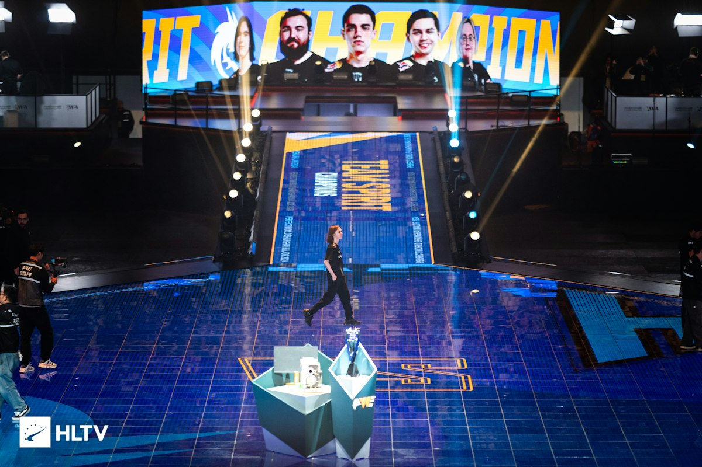

  

 

<h1 align="center">Hi, I'm Quasimoto</h1>

  Backend developer · Python · learning Rust · Linux and quantum computing enthusiast

  
  
  
  

 

> *"If anything deserves a reward, it is social contribution. Creativity can be a social contribution, but only in so far as society is free to use the results. If programmers deserve to be rewarded for creating innovative programs, by the same token they deserve to be punished if they restrict the use of these programs."*
>
> — Richard Stallman, *The GNU Manifesto*, 1985

---

## About me

I'm a backend developer who specializes in **Python**, and I'm currently learning **Rust**
to use in future projects. My main interests right now are:

- **Quantum computing**, using IBM's Qiskit library
- **Operating systems**, mostly Linux

Expect most of my future projects to relate to one of those two things!

## Current project: [GRNU](https://github.com/KermitTheMagnificant/GRNU)

  

*(pronounced "gr-knew")* is my attempt to rewrite as much of GNU as I can in Rust.
It's in very early development, but [check it out](https://github.com/KermitTheMagnificant/GRNU)!

## Tech I use

  
  
  
  
  
  
  
  

 

  

---

## Wall of photos

  
   
  <em>Cleveland Cavaliers overcome 3-1 deficit to win the NBA Championship · Oakland, California · June 21, 2016</em>

 

  
   
  <em>Team Spirit wins the Shanghai Major · Shanghai, China · December 15, 2024</em>

 

  

